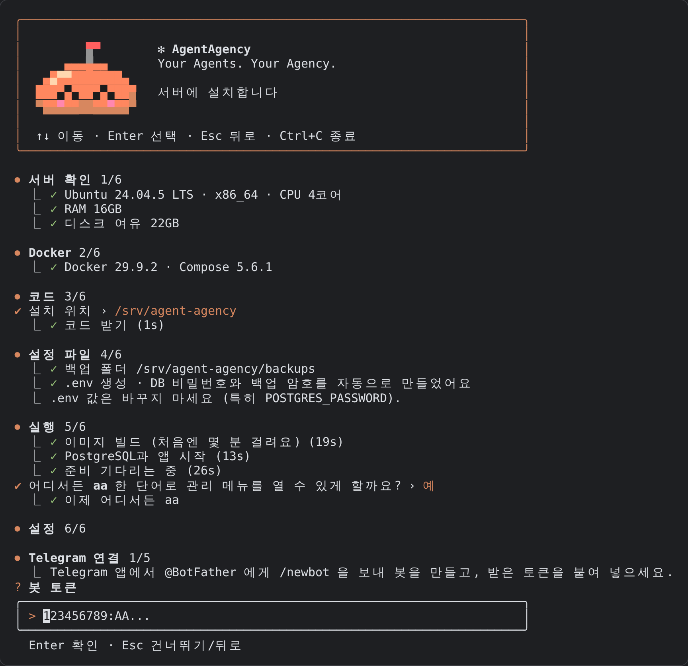

# AgentAgency

**Your Agents. Your Agency.**

AgentAgency는 사용자가 AI 에이전트 조직을 구성하고 목표를 지시하면, 진행자 AI와 개별 에이전트가 Telegram에서 실제로 토론·분업·실행·검증·보고하는 **오픈소스 자체 호스팅 멀티 에이전트 운영 플랫폼**입니다. 첫 업무 유형은 소프트웨어 개발(Coding Agency)입니다.

- 설치: [설치 가이드](docs/INSTALL.md) · 기능: [기능 안내](docs/features.md)
- 요구사항: [PRD](docs/prd/AgentAgency_PRD.md) · 구현 현황: [요구사항별 구현 상태](docs/requirements-status.md)
- 구조: [아키텍처](docs/architecture.md) · 배포: [클라우드 중립 배포 가이드](docs/deployment.md) · 기술 검증: [실행기 검증 기록](docs/phase0-verification.md)

## 무엇을 하나요

| 영역 | 내용 |
|---|---|
| 조직 경험 | 회사·건설현장·대학에 레스토랑 주방·우주 관제센터·모험가 길드까지 여섯 가지 세계관(`/mode 주방`). 같은 사실을 발화자·청자 관계와 직책에 맞는 짧은 말투로 표현합니다. 친밀도는 표현에만 영향을 줍니다. |
| 보이는 협업 | 단일 Telegram 봇이 마스터 라운지와 프로젝트 Topic에서 AI별 이름·역할·발화 대상을 표시합니다. 진행 상황은 고정 메시지 하나로 보여 줍니다. |
| 실제 산출물 | 기획 → 구현 → 품질 게이트(테스트·lint·타입·보안·Playwright) → 교차 리뷰 → 수정 → GitHub PR → 승인 후 병합 순으로 진행합니다. |
| 통제 가능한 자율성 | 기본은 단계마다 승인 버튼을 거칩니다. "자동으로 진행해"(또는 `/auto on`)라고 하면 계획·PR 병합 같은 일상 승인은 알아서 넘기고, 운영 배포·DB, 삭제, 유료 API 같은 위험한 작업만 묻습니다. 위험한 작업은 재확인을 한 번 더 요구합니다. |
| 구독 우선 | 공식 구독 Cloud를 먼저 쓰고, 안 되면 격리된 Local CLI로 전환합니다. 종량제 유료 API는 기본 비활성이며 자동 전환하지 않습니다. |
| 영구 기억 | PostgreSQL이 대화·기억·작업 상태의 원천입니다. Context Builder가 필요한 맥락만 골라 전달합니다. |

## 빠른 시작 (Docker Compose, 단일 Linux 서버)

처음 설치한다면 서버 준비부터 Telegram 운영 시작까지 순서대로 정리한 [설치 가이드](docs/INSTALL.md)를 따라 하세요. 아래는 요약입니다.

서버에 SSH로 접속해 명령 하나로 시작합니다.

```bash
curl -fsSL https://raw.githubusercontent.com/onlinehood/agent-agency/main/install.sh -o install.sh && bash install.sh
```

그다음은 전부 터미널 화면(Claude Code 스타일)이 안내합니다. 서버 확인 → Docker 설치 → 코드 받기(`/srv/agent-agency`) → `.env`와 비밀번호 자동 생성 → 빌드·실행 → 이어서 설정. 브라우저나 SSH 터널은 필요 없습니다.



1. Telegram 봇 토큰을 넣고, 그룹에 메시지를 하나 보낸 뒤 Enter를 누르면 그룹과 관리자를 자동으로 찾습니다.
2. 가진 AI 구독(Claude, Codex, Gemini)을 고르면 그 자리에서 로그인 화면을 띄우고 실제 실행으로 검증합니다.
3. GitHub를 연결합니다. 개인 계정은 Fine-grained PAT, 조직은 GitHub App을 권장합니다.
4. 실행 우선순위, 조직 세계관, 초기 에이전트를 정합니다.
5. 전체 진단과 엔드투엔드 스모크 테스트를 마치면 Telegram 운영이 시작됩니다.

운영 중에는 `aa` 한 단어로 관리 메뉴(설정 바꾸기, 상태, 로그, 진단, 백업, 업데이트, 재시작)를 엽니다. 설정은 `aa config` 하나로 모든 설정(Telegram, AI 구독, GitHub, 실행 정책, 세계관, 에이전트, 기능 플래그, 유료 API, 백업, 인증정보 차단)을 메뉴에서 고칩니다. 웹 대시보드는 선택 사항입니다(`aa web`).

공개 도메인 없이 Telegram Long Polling으로 동작합니다.

## Telegram에서

- 마스터 라운지: `새 프로젝트 만들어줘 "가계부"` 라고 말하면 AI 팀이 토론해 이름·스택·팀·비공개 저장소를 제안합니다. 승인하면 Topic이 생성되고, "▶️ 설명대로 바로 시작" 버튼으로 첫 작업을 바로 시작할 수 있습니다. 진행 중인 프로젝트가 하나뿐이면 라운지에서 `알아서 만들어봐` 처럼 말해도 그 프로젝트의 작업으로 접수됩니다.
- 리서치: `AI 코딩 도구 시장 조사 보고서 프로젝트 만들어줘` 또는 `/new research <주제>` 로 출처가 달린 보고서를 만드는 리서치 프로젝트를 시작합니다.
- 기존 저장소: `https://github.com/org/repo 가져와줘` 라고 말하면 읽기 전용으로 분석하고 팀 구성안을 냅니다. 승인한 뒤에만 연결합니다.
- 프로젝트 Topic: `@클로드 로그인 화면 추가해줘` 처럼 작업을 지시합니다. `다들 어떻게 생각해?`, `아이디어 있어?` 같은 팀 질문에는 여러 에이전트가 각자 답합니다. `나중에 다크모드 있으면 좋겠다` 같은 아이디어 문장은 후보 목록에 저장됩니다.
- 명령어: `/status` `/mode` `/agents` `/agent` `/team` `/approvals` `/usage` `/experiment` `/baseline` `/maintenance` `/upgrade` `/exec` `/executors` `/pause` `/resume` `/cancel` `/priority` `/complete` `/archive` `/restore` `/delete` `/ideas` `/flags`
- 승인 카드의 "✏️ 수정 요청"을 누르고 고칠 점을 메시지로 보내면 그 의견을 반영해 다시 기획하거나 같은 PR을 수정합니다.

## 개발

```bash
npm install
npm run check        # typecheck + lint + test
TEST_DATABASE_URL=postgres://postgres@localhost:5432/postgres npm test   # 실제 PostgreSQL 통합 테스트 포함
npm run dev          # DATABASE_URL이 없으면 내장 PostgreSQL(PGlite) 사용
```

CLI: `agent-agency start | migrate | doctor | verify-executor <id> | backup | restore <file> | upgrade-check | setup-token`

## 원칙

- 공식 구독 인증으로 할 수 없는 자동화는 쿠키 추출이나 비공식 세션 자동화로 우회하지 않습니다.
- 확인되지 않은 기능은 "지원됨"으로 표시하지 않습니다. 진단 화면에 지원/미지원/미확인과 그 사유를 그대로 보여 줍니다.
- 세계관·친밀도는 표현 레이어일 뿐입니다. 품질 게이트, 보안, 승인, 권한, 비용 정책은 모든 모드에서 같습니다.

## 라이선스

[MIT](LICENSE)
