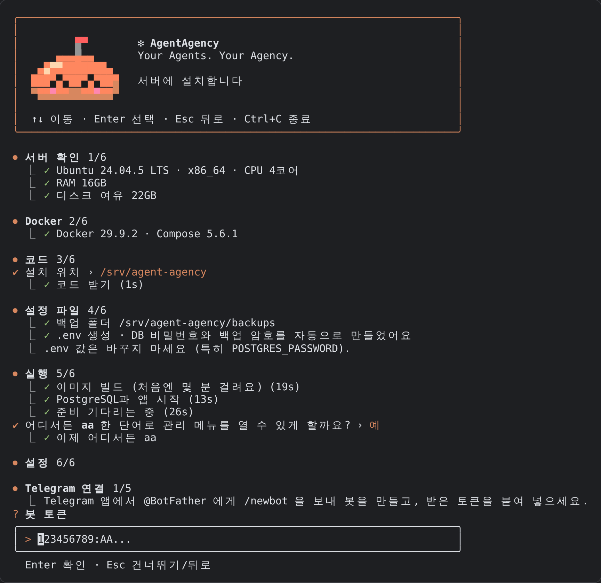
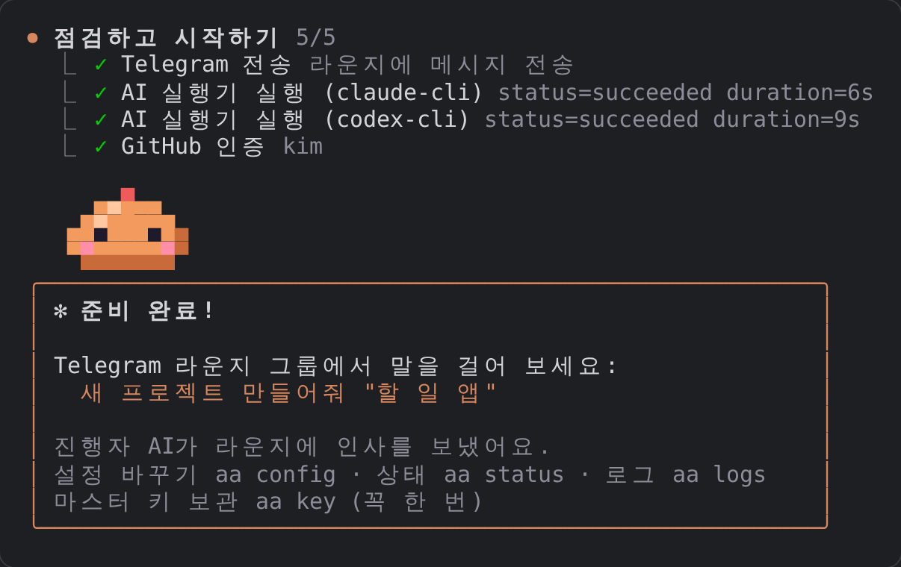
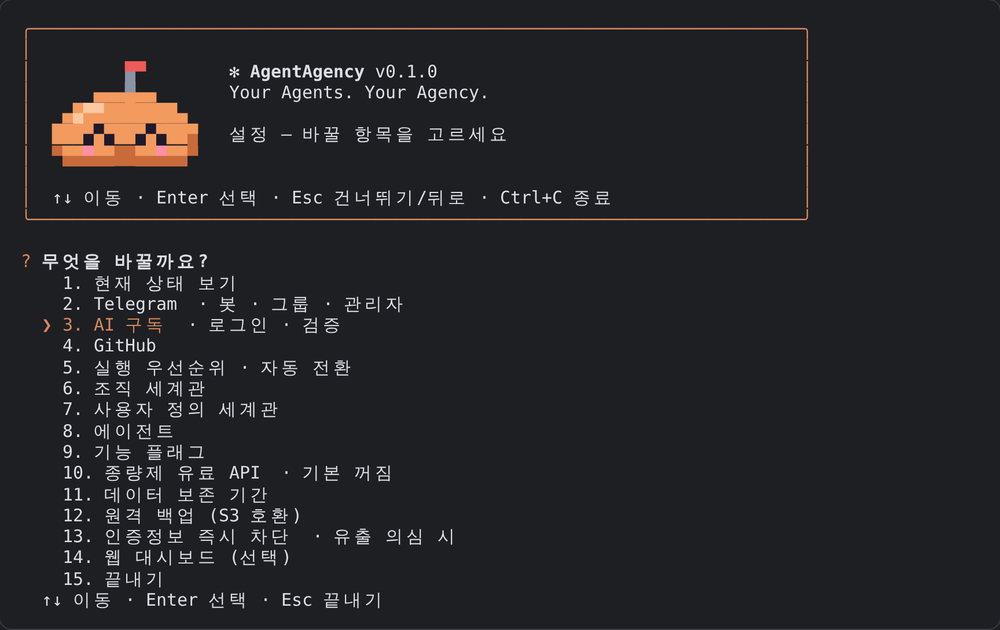
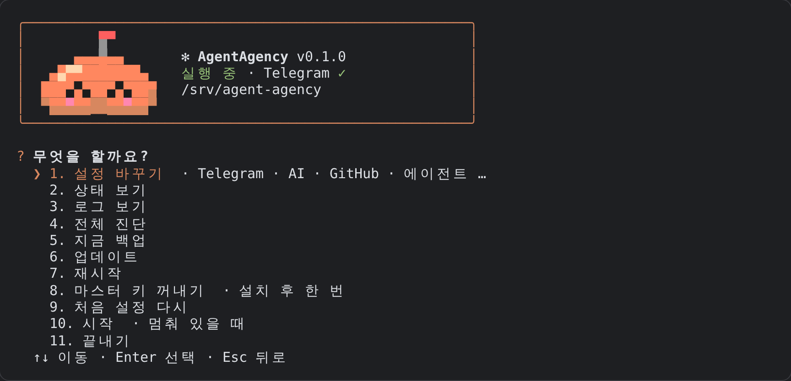

# AgentAgency 설치 가이드 (처음부터 운영 시작까지)

빈 Linux 서버에서 시작해 Telegram으로 AI 팀에게 첫 작업을 시키기까지의 과정입니다. 명령은 Ubuntu 22.04/24.04 기준입니다.

준비물:

- Linux 서버(클라우드 VM, VPS, 집 서버 모두 가능)와 SSH 접속
- Telegram 계정
- 하나 이상의 AI 구독: Claude Pro/Max, ChatGPT Plus/Pro(Codex) 등
- GitHub 계정 (선택: 없으면 로컬 저장소로만 작업)

## 빠른 설치 (추천) — 명령 하나

서버에 SSH로 접속해 아래 명령 하나만 실행하면, 나머지는 터미널 화면이 한 단계씩 안내합니다. Docker 설치, 코드 받기(`/srv/agent-agency`), PostgreSQL 비밀번호, 실행, Telegram·AI 설정까지 모두 이 화면에서 끝납니다.

```bash
curl -fsSL https://raw.githubusercontent.com/onlinehood/agent-agency/main/install.sh -o install.sh && bash install.sh
```

이미 `git clone` 해 둔 폴더가 있다면 그 안에서 `bash install.sh` 만 실행해도 됩니다.

<details>
<summary>포크를 비공개 저장소로 운영하는 경우</summary>

비공개 저장소는 이 저장소만 읽을 수 있는 토큰이 필요합니다.

1. GitHub → Settings → Developer settings → Personal access tokens → **Fine-grained tokens** → Generate new token
2. Repository access: **Only select repositories** → 해당 저장소 · 권한 **Contents: Read-only**
3. 토큰을 입력받고(화면에 보이지 않는 것이 정상), 설치 프로그램을 받습니다. `<owner>/<repo>`는 실제 저장소로 바꿉니다.

```bash
read -rsp "GitHub 토큰: " AA_GITHUB_TOKEN; echo; export AA_GITHUB_TOKEN
```

```bash
curl -fsSL -H "Authorization: Bearer $AA_GITHUB_TOKEN" -H "Accept: application/vnd.github.raw" https://api.github.com/repos/<owner>/<repo>/contents/install.sh -o install.sh && AA_REPO_URL=https://github.com/<owner>/<repo>.git bash install.sh
```

토큰은 `.git` 설정에 남기지 않고 git 자격 증명 저장소에만 넣어, 나중에 `aa update`가 그대로 씁니다. SSH 배포 키를 쓰고 싶다면 [2.2](#22-코드-받기)를 보세요.

</details>

### 설치 화면

Claude Code처럼 한 단계씩 진행됩니다. 질문에는 ↑↓(또는 숫자)와 Enter로 답합니다.



```
⏺ 서버 확인 1/6
  ⎿  ✓ Ubuntu 24.04.5 LTS · x86_64 · CPU 4코어
  ⎿  ✓ RAM 16GB
  ⎿  ✓ 디스크 여유 24GB

⏺ Docker 2/6
  ⎿  ✓ Docker 29.9.2 · Compose 5.6.1

⏺ 코드 3/6
✔ 설치 위치 › /srv/agent-agency
  ⎿  ✓ 코드 받기 (3s)

⏺ 설정 파일 4/6
  ⎿  ✓ 백업 폴더 /srv/agent-agency/backups
  ⎿  ✓ .env 생성 · DB 비밀번호와 백업 암호를 자동으로 만들었어요
  ⎿  .env 값은 바꾸지 마세요 (특히 POSTGRES_PASSWORD).

⏺ 실행 5/6
  ⎿  ✓ 이미지 빌드 (처음엔 몇 분 걸려요) (214s)
  ⎿  ✓ PostgreSQL과 앱 시작 (11s)
  ⎿  ✓ 준비 기다리는 중 (5s)
✔ 어디서든 aa 한 단어로 관리 메뉴를 열 수 있게 할까요? › 예
  ⎿  ✓ 이제 어디서든 aa

⏺ 설정 6/6

⏺ Telegram 연결 1/5
```

1. **서버 확인**: OS, CPU, RAM, 디스크를 보고 부족하면 알려 줍니다.
2. **Docker**: 없으면 설치할지 묻고 설치합니다.
3. **코드**: 설치 위치(기본 `/srv/agent-agency`)를 묻고 받습니다.
4. **설정 파일**: PostgreSQL 비밀번호와 백업 암호를 자동으로 만들어 `.env`에 넣습니다.
5. **실행**: 이미지를 빌드하고(처음엔 몇 분) PostgreSQL과 앱을 시작합니다. `aa` 한 단어로 관리 메뉴를 열 수 있게 할지 묻습니다.
6. **설정**: 바로 아래 ③으로 이어집니다.

중간에 멈췄다면 같은 명령을 다시 실행하면 됩니다. 이미 끝난 단계는 건너뜁니다.

### ③ 이어지는 설정 (Telegram · AI · GitHub)

설치에 이어 같은 화면에서 계속됩니다. 화살표(↑↓)로 고르고 Enter, 건너뛰려면 Esc입니다.

```
╭────────────────────────────────────────────────────────────────────╮
│                                                                    │
│         ██                                                         │
│    ▄██████████▄     ✻ AgentAgency v0.1.0                           │
│    ██  ████  ██     Your Agents. Your Agency.                      │
│    ████▀▀▀▀████                                                    │
│     ██▀▀▀▀▀▀██      Telegram으로 일하는 AI 팀을 준비합니다         │
│                                                                    │
│   ↑↓ 이동 · Enter 선택 · Esc 건너뛰기/뒤로 · Ctrl+C 종료           │
╰────────────────────────────────────────────────────────────────────╯

⏺ Telegram 연결 1/5
  ⎿  Telegram 앱에서 @BotFather 에게 /newbot 을 보내 봇을 만들고, 받은 토큰을 붙여 넣으세요.
? 봇 토큰
╭──────────────────────────────────────────────────────────────────────╮
│ > 123456789:AA...                                                    │
╰──────────────────────────────────────────────────────────────────────╯
  Enter 확인 · Esc 건너뛰기/뒤로
```

설정이 끝나면 이렇게 보입니다.



1. **Telegram**: BotFather에게 받은 봇 토큰을 붙여 넣습니다. 그룹을 만들어 봇을 초대하고 메시지를 하나 보낸 뒤 Enter를 누르면 그룹과 내 계정을 자동으로 찾아 목록으로 보여 줍니다. 숫자 ID를 찾을 필요가 없습니다.
2. **AI 구독 로그인**: 가진 구독(Claude, Codex, Gemini)을 고르면 로그인 화면을 바로 띄우고, 로그인 후 실제로 짧게 실행해 검증까지 합니다.
3. **GitHub**: 토큰을 붙여 넣거나 "나중에".
4. **기본 설정**: 실행 우선순위, 조직 세계관, 처음 만들 AI 에이전트의 이름과 성격.
5. **점검**: 전체 진단과 스모크 테스트(라운지 메시지 · AI 실제 실행 · GitHub 확인). 끝나면 진행자 AI가 라운지에 인사합니다.

끝입니다. 이제 Telegram 그룹에서 `새 프로젝트 만들어줘 "할 일 앱"` 이라고 말해 보세요.

나중에 무엇이든 바꾸려면 `aa config` 를 실행합니다.


 Telegram, AI 구독, GitHub, 실행 우선순위, 세계관, 에이전트, 기능 플래그, 유료 API, 백업, 인증정보 차단까지 모두 같은 메뉴에 있습니다. 설정을 중간에 멈췄다면 `aa setup` 으로 이어서 합니다.

### 관리 메뉴 (`aa`)



`aa` 한 단어만 입력하면 관리 메뉴가 열립니다(설정 바꾸기, 상태, 로그, 진단, 백업, 업데이트, 재시작 …). 설치 때 `aa` 등록을 건너뛰었다면 설치 폴더에서 `./aa` 로 실행합니다. 짧은 명령으로 바로 실행할 수도 있습니다.

| 명령 | 하는 일 |
|---|---|
| `aa setup` | 처음 설정 (이어서 하기) |
| `aa config` | 설정 바꾸기 (모든 설정) |
| `aa status` | 실행 상태 |
| `aa logs` | 로그 보기 (Ctrl+C로 나가기) |
| `aa login claude` / `codex` / `gemini` | AI 구독 로그인 |
| `aa doctor` | 전체 연결 진단 |
| `aa key` | 마스터 키 꺼내기 (설치 후 한 번 꼭 보관, [7.1](#71-꼭-해-둘-백업-마스터-키)) |
| `aa backup` | 지금 백업 |
| `aa update` | 최신 버전으로 업데이트 |
| `aa restart` / `aa stop` | 재시작 / 중지 |
| `aa cursor` | Cursor Agent CLI 설치 (기본 이미지에는 없음) |
| `aa web` | (선택) 웹 대시보드 접속 방법 |

---

# 자세한 설명

아래는 각 단계를 스크립트 없이 직접 하는 방법과 화면별 설명입니다. 빠른 설치가 잘 됐다면 필요한 부분만 찾아 보면 됩니다.

**PostgreSQL은 따로 설치하지 않습니다.** Docker Compose가 PostgreSQL 16 컨테이너를 함께 띄우고, 데이터베이스와 계정도 처음 실행할 때 자동으로 만듭니다. 여러분이 할 일은 비밀번호 하나를 정하는 것뿐입니다(설치 스크립트는 이것도 자동으로 만듭니다).

## 전체 흐름

1. 서버 준비 (Docker 설치)
2. 설치 위치(`/srv/agent-agency`) 만들기, 코드 받기, 설정 파일(`.env`) 만들기
3. 실행 (PostgreSQL과 앱 컨테이너 시작)
4. 터미널 설정 시작 (`aa setup`)
5. 설정: Telegram → AI 구독 로그인 → GitHub → 기본 설정 → 점검
6. Telegram에서 첫 프로젝트 시작
7. 운영: 백업, 업데이트, 문제 해결

---

## 1. 서버 준비

### 1.1 사양

| 규모 | vCPU | RAM | 디스크 |
|---|---|---|---|
| 최소 (AI 작업 1개씩) | 2 | 4GB | 30GB |
| 권장 (동시 2개) | 4 | 8~16GB | 60GB |

OCI Always Free(ARM), AWS, Azure, GCP, 일반 VPS 모두 됩니다. 특정 클라우드 기능은 쓰지 않습니다.

> **RAM 1GB 서버(예: OCI Always Free의 AMD 인스턴스)는 권장하지 않습니다.** PostgreSQL, 앱, AI CLI가 함께 돌기에는 빠듯해서 작업이 자주 미뤄집니다. OCI라면 같은 무료 등급의 **Ampere A1(ARM, 최대 4 OCPU · 24GB)** 인스턴스를 쓰세요. 꼭 작은 서버를 써야 한다면 아래 "작은 서버에 스왑 추가"를 하세요.

### 1.1.1 작은 서버에 스왑 추가 (RAM 4GB 미만일 때)

디스크 일부를 메모리처럼 쓰게 해 메모리 부족을 덜어 줍니다. 느려지지만 작업이 멈추지는 않습니다. 아래는 4GB 스왑을 만들고 재부팅 후에도 유지하는 명령입니다.

```bash
sudo fallocate -l 4G /swapfile && sudo chmod 600 /swapfile && sudo mkswap /swapfile && sudo swapon /swapfile
```

```bash
echo '/swapfile none swap sw 0 0' | sudo tee -a /etc/fstab
```

`free -h`의 Swap 줄에 4.0Gi가 보이면 됩니다. AgentAgency는 남은 스왑의 절반을 사용 가능한 메모리로 계산합니다.

### 1.2 Docker 설치

서버에 SSH로 접속해 실행합니다.

```bash
curl -fsSL https://get.docker.com | sudo sh
```

```bash
sudo usermod -aG docker $USER
```

그룹 변경을 적용하려면 SSH를 끊고 다시 접속합니다. 그다음 버전을 확인합니다.

```bash
docker compose version
```

`v2.24` 이상이면 됩니다. 더 낮으면 Docker를 업데이트하세요.

### 1.3 방화벽

열어야 할 포트는 **SSH(22)뿐**입니다.

- 설정은 SSH로 접속한 터미널에서 합니다. (선택 사항인 웹 대시보드도 서버 내부(127.0.0.1)에서만 열리고 SSH 터널로 접속합니다.)
- Telegram은 서버가 바깥으로 연결하는 방식(Long Polling)이라 들어오는 포트가 필요 없습니다.

---

## 2. 코드 받기와 설정 파일

### 2.1 설치 위치 만들기

이 가이드는 **`/srv/agent-agency`** 에 설치합니다. 이후의 모든 명령은 이 폴더 안에서 실행한다고 가정합니다. 로그인한 사용자(예: `ubuntu`)가 쓸 수 있게 폴더를 만들어 둡니다.

```bash
sudo mkdir -p /srv/agent-agency && sudo chown $USER:$USER /srv/agent-agency
```

### 2.2 코드 받기

공개 저장소이므로 바로 받습니다.

```bash
git clone https://github.com/onlinehood/agent-agency.git /srv/agent-agency
```

포크를 **비공개(private)** 저장소로 운영한다면 두 가지 방법이 있습니다.

- **읽기 전용 토큰** (가장 간단): 빠른 설치의 "포크를 비공개 저장소로 운영하는 경우"를 따라 하면 됩니다.
- **배포 키(Deploy key)**: 아래 절차. 그 저장소 하나만 읽을 수 있는 SSH 키를 서버에 만듭니다. 서버가 털려도 다른 저장소나 GitHub 계정은 안전합니다.

1. 서버에서 키를 만들고 공개 키를 출력합니다.

   ```bash
   ssh-keygen -t ed25519 -C "agent-agency deploy" -f ~/.ssh/agent_agency_deploy -N ""
   ```

   ```bash
   cat ~/.ssh/agent_agency_deploy.pub
   ```

2. 출력된 `ssh-ed25519 ...` 한 줄을 GitHub에 등록합니다.
   - 저장소 → Settings → Deploy keys → Add deploy key
   - Title은 서버 이름, Key는 복사한 내용을 넣습니다.
   - **Allow write access는 체크하지 않습니다.**

3. 서버의 SSH 설정에 키를 연결합니다.

   ```bash
   cat >> ~/.ssh/config <<'EOF'
   Host github-agent-agency
     HostName github.com
     User git
     IdentityFile ~/.ssh/agent_agency_deploy
     IdentitiesOnly yes
   EOF
   ```

   ```bash
   chmod 600 ~/.ssh/config
   ```

4. 받습니다. 처음 접속할 때 `Are you sure you want to continue connecting?`가 나오면 `yes`를 입력합니다.

   ```bash
   git clone git@github-agent-agency:<owner>/<repo>.git /srv/agent-agency
   ```

나중에 업데이트할 때 쓰는 `git pull`도 이 키로 그대로 동작합니다.

이제 설치 폴더로 이동합니다. 이후 명령은 모두 이 위치에서 실행합니다.

```bash
cd /srv/agent-agency
```

### 2.3 백업 폴더 만들기

백업은 서버의 `/srv/agent-agency/backups` 폴더에 저장됩니다. 앱은 UID 1000 사용자로 실행되므로, 폴더를 미리 만들고 소유자를 맞춰 둡니다. 이 단계를 건너뛰면 Docker가 root 소유로 폴더를 만들어 백업이 실패합니다.

```bash
mkdir -p backups && sudo chown 1000:1000 backups
```

### 2.4 `.env` 만들기

```bash
cp .env.example .env
```

PostgreSQL 비밀번호로 쓸 값을 생성합니다.

```bash
openssl rand -hex 24
```

나온 값을 `.env`의 `POSTGRES_PASSWORD=` 뒤에 붙여 넣습니다. 편집기는 무엇이든 됩니다.

```bash
nano .env
```

```
POSTGRES_PASSWORD=여기에_생성된_값
```

비밀번호 규칙:

- 영문과 숫자만 쓰세요. `@ : / # ? %` 같은 문자가 들어가면 앱이 DB에 접속하지 못합니다(접속 주소에 그대로 들어가기 때문).
- **첫 실행 전에 정하고 바꾸지 마세요.** PostgreSQL은 처음 시작할 때 이 값으로 계정을 만듭니다. 나중에 `.env`만 바꾸면 접속이 끊깁니다.

선택 설정 (나중에 해도 됩니다):

| 항목 | 설명 |
|---|---|
| `AA_BACKUP_PASSPHRASE` | 백업 파일 암호화 암호. 원격 백업을 쓰려면 필수. `openssl rand -hex 24`로 생성 |
| `AA_MAX_CONCURRENT_PROJECTS` | 동시에 진행할 프로젝트 수 상한(기본 2). 실제 CPU·RAM에 맞춰 자동으로 더 낮아집니다 |

Telegram 토큰, GitHub 토큰 같은 나머지 값은 `.env`에 넣지 않습니다. 설정(`aa setup` / `aa config`)에서 입력하면 암호화되어 DB에 저장됩니다.

---

## 3. 실행

설치 폴더에서 실행합니다.

```bash
cd /srv/agent-agency
```

```bash
docker compose up -d --build
```

처음에는 이미지를 빌드하느라 몇 분 걸립니다. 이 명령이 하는 일:

1. `db` 컨테이너: PostgreSQL 16을 시작하고, 데이터베이스 `agentagency`와 계정 `agentagency`를 `.env`의 비밀번호로 만듭니다. 데이터는 Docker 볼륨 `pgdata`에 저장되어 컨테이너를 지우고 다시 만들어도 남습니다.
2. `app` 컨테이너: DB가 준비되면 시작해 테이블을 자동으로 만들고(마이그레이션), Telegram 봇과 작업 스케줄러를 시작합니다.

상태를 확인합니다. 두 서비스 모두 `running`(db는 `healthy`)이면 정상입니다.

```bash
docker compose ps
```

PostgreSQL이 제대로 만들어졌는지 직접 보고 싶다면:

```bash
docker compose exec db psql -U agentagency -d agentagency -c "\dt"
```

`users`, `projects`, `tasks` 같은 테이블 목록이 나오면 됩니다.

---

## 4. 터미널 설정 시작

설치 폴더에서 실행합니다. `install.sh`로 설치했다면 이미 이 화면이 떠 있습니다.

```bash
cd /srv/agent-agency && aa setup
```

`aa setup` 은 `docker compose exec -it app agent-agency setup` 과 같습니다. 중간에 멈춰도 저장된 설정은 그대로이며, 다시 실행하면 이어서 합니다.

---

## 5. 설정 단계

조작법:

| 키 | 동작 |
|---|---|
| ↑ ↓ (또는 숫자) | 고르기 |
| Space | 여러 개 고를 때 선택/해제 |
| Enter | 확인 |
| Esc | 이 단계 건너뛰기 (`aa config` 에서 나중에) |
| Ctrl+C | 멈추기 |

### 5.2 Telegram 연결

두 단계로 안내합니다. 숫자 ID를 직접 찾을 필요는 없습니다.

**① 봇 만들고 토큰 넣기**

1. Telegram에서 `@BotFather`를 찾아 `/newbot`을 보냅니다.
2. 봇 이름과 사용자명(`..._bot`으로 끝나야 함)을 정합니다.
3. 받은 **봇 토큰**(`123456789:AA...` 형식)을 붙여 넣고 Enter. 화면에는 `•••`로만 보입니다. 토큰은 비밀번호처럼 취급하세요.

**② 그룹 만들고 자동으로 찾기**

1. 새 그룹을 만들고 방금 만든 봇을 초대합니다.
2. 그룹 설정 → **주제(Topics)** 를 켭니다. 프로젝트마다 Topic이 하나씩 생깁니다.
3. 그룹 설정 → 관리자 → 봇을 관리자로 지정하고 아래 권한을 켭니다.
   - 주제 관리(Manage Topics)
   - 메시지 고정(Pin Messages)
4. 그룹에 아무 메시지나 하나 보냅니다(예: `안녕`).
5. 터미널에서 Enter를 누릅니다. 방금 메시지를 보낸 그룹과 내 계정을 자동으로 찾아 목록으로 보여 줍니다.
6. 그룹을 고르고, 봇을 조작할 사람(본인)을 Space로 고른 뒤 Enter. 고른 사람만 봇을 조작할 수 있습니다.

봇이 관리자이면 그룹의 모든 메시지를 받으므로 BotFather의 privacy 설정은 바꾸지 않아도 됩니다. 목록에 그룹이 안 나오면 그룹에 메시지를 하나 더 보내고 다시 찾아 보세요. 숫자 ID를 알고 있다면 "직접 입력"을 골라 넣어도 됩니다.

저장하면 아래 항목을 확인합니다. 모두 ✓ 여야 하며, ✗ 항목은 이유가 함께 표시됩니다.

- 봇 토큰
- 포럼(Topic) 그룹
- 봇 관리자 권한
- Topic 관리 권한
- 메시지 고정 권한

### 5.3 AI 구독 로그인

AgentAgency는 **구독 계정으로 로그인한 공식 CLI**만 씁니다. API 키(유료 종량제)로 로그인하면 사용하지 않습니다. 로그인 정보는 Docker 볼륨에 저장되어 컨테이너를 다시 만들어도 유지됩니다.

설정 화면이 설치된 AI CLI와 로그인 상태를 보여 줍니다. 가진 구독을 Space로 고르고 Enter를 누르면, 아래 로그인 명령을 **그 자리에서 실행**하고 이어서 검증합니다. 따로 명령을 칠 필요가 없습니다. (`aa login claude` 처럼 직접 해도 됩니다.)

**Claude (Pro/Max 구독)**

```bash
docker compose exec -it app claude auth login --claudeai
```

화면에 나온 주소를 내 PC 브라우저에서 열어 로그인하고, 받은 코드를 서버 창에 붙여 넣습니다. `--console`(API 과금) 옵션은 쓰지 마세요.

브라우저 연동이 번거로우면 대신 이렇게 할 수 있습니다.

1. 내 PC에 Claude Code가 설치되어 있으면 아래 명령으로 장기 토큰을 만듭니다.

   ```bash
   claude setup-token
   ```

2. 나온 토큰을 서버 `.env`에 `CLAUDE_CODE_OAUTH_TOKEN=...` 로 넣고 다시 시작합니다.

   ```bash
   docker compose up -d
   ```

**Codex (ChatGPT Plus/Pro 구독)**

```bash
docker compose exec -it app codex login --device-auth
```

화면에 나온 주소와 코드로 브라우저에서 ChatGPT 계정 로그인을 마칩니다. `--with-api-key`는 쓰지 마세요.

**Gemini (선택, Google 계정)**

```bash
docker compose exec -it -e NO_BROWSER=true app gemini
```

"Login with Google"을 고르고, 화면의 주소를 브라우저에서 열어 로그인한 뒤 받은 코드를 붙여 넣고 `/quit`로 나옵니다. 설정에서 Gemini를 고르면 기능 플래그 `executors.gemini`도 자동으로 켜집니다.

**Cursor (선택, Cursor 구독)**

Cursor Agent CLI는 기본 이미지에 들어 있지 않습니다. 먼저 서버에서 설치합니다(이미지를 다시 빌드하므로 몇 분 걸립니다).

```bash
aa cursor
```

`.env`에 `INSTALL_CURSOR_CLI=true`가 들어가서 `aa update` 뒤에도 유지됩니다. 설치가 끝나면 `aa config` → AI 구독에서 Cursor를 골라 로그인합니다(`cursor-agent login`, 기능 플래그 `executors.cursor`도 자동으로 켜짐).

**나중에 추가하기**

처음 설정에서 고르지 않은 AI도 언제든 `aa config` → **AI 구독**에서 Space로 고르고 Enter를 누르면 로그인과 검증을 이어서 합니다. 그다음 `aa config` → **에이전트** → 에이전트 추가에서 그 실행기로 에이전트를 만들면 팀에 합류합니다.

**검증**

로그인이 끝나면 실제로 짧은 읽기 전용 요청을 보내 동작을 확인합니다. 통과한 실행기만 작업에 쓰입니다. 실패하면 이유를 보여 주고 다시 로그인할지 묻습니다.

Codex Cloud(선택, 실험 기능)의 환경 ID는 `aa config` → AI 구독 에서 넣습니다.

### 5.4 GitHub 연결

AI 팀은 작업 결과를 GitHub PR로 올립니다. 계정 종류에 따라 방식을 고릅니다.

| 상황 | 권장 방식 | 이유 |
|---|---|---|
| **개인 계정**에 새 저장소를 만들게 하려면 | Fine-grained Personal Access Token | GitHub App은 개인 계정에 저장소를 새로 만들 수 없습니다 |
| **조직(Organization)** 저장소 | GitHub App | 필요한 저장소에만 최소 권한으로 설치할 수 있습니다 |
| 일단 GitHub 없이 써 보기 | "나중에" | 서버 안의 로컬 저장소로만 작업합니다. PR은 만들지 않습니다 |

**Fine-grained PAT 만들기**

1. GitHub → Settings → Developer settings → Personal access tokens → Fine-grained tokens → Generate new token
2. Repository access: All repositories (새 저장소를 만들려면 필요)
3. Repository permissions:
   - Administration: Read and write (저장소 생성)
   - Contents: Read and write
   - Pull requests: Read and write
   - Metadata: Read-only (자동으로 "Required"로 들어갑니다)

   Fine-grained 토큰 화면에는 "Checks" 권한이 없습니다. 필요 없으니 찾지 않아도 됩니다.
4. 만든 토큰(`github_pat_...`)을 설정 화면에 붙여 넣습니다. 이어서 새 저장소를 만들 계정/조직을 묻습니다(기본값: 토큰 주인).

**GitHub App 만들기 (조직용)**

1. 조직 Settings → Developer settings → GitHub Apps → New GitHub App
2. 이름과 Homepage URL(아무 주소)을 입력하고, Webhook의 "Active" 체크를 해제합니다.
3. Repository permissions를 PAT와 같게 지정합니다(Administration 쓰기는 조직에 새 저장소를 만들 때 필요). GitHub App에는 Checks 권한도 있지만 필수는 아닙니다.
4. 만든 뒤 "Generate a private key"로 키 파일(.pem)을 내려받습니다.
5. "Install App"에서 조직에 설치합니다. 설치 후 주소창의 `.../installations/숫자` 가 Installation ID입니다.
6. 설정 화면에 App ID, Installation ID를 넣고, 키 파일(.pem) 내용을 통째로 붙여 넣습니다(마지막 줄 `-----END ... PRIVATE KEY-----`에서 자동으로 확인됩니다). 마지막으로 조직 이름을 넣습니다.

### 5.5 기본 설정

- **실행 우선순위**: 기본값 "공식 구독 Cloud → 격리된 Local CLI"를 그대로 두면 됩니다. Cloud 실행기는 검증 전에는 자동으로 건너뛰므로 실제로는 Local CLI가 쓰입니다.
- **자동 전환**: 실행기에 문제가 생기면 다른 구독 실행기로 넘어갑니다. 종량제 유료 API로는 절대 넘어가지 않습니다.
- **조직 세계관**: 회사(CEO·수석비서·팀장), 노가다(건물주·십장·현장 작업자), 대학(교수·조교·학생) 중에 고릅니다. 언제든 Telegram에서 `/mode`로 바꿀 수 있습니다.
- **초기 에이전트**: 로그인한 구독에 맞춰 에이전트(클로드, 코덱스, 제미니)를 고르고 이름, 성격, **모습**을 정합니다. 첫 번째 에이전트가 진행자 AI가 됩니다. 나중에 `aa config` → 에이전트 에서 추가·수정합니다.

**에이전트 캐릭터**

에이전트마다 작은 캐릭터가 하나씩 생깁니다. **모양 · 색 · 소품**을 골라 꾸미고, **표정은 지금 하는 일**을 보여 줍니다(쉬는 중, 일하는 중, 승인 기다림, 막힘, 완료). 설정 화면, 완료 화면, `aa` 관리 메뉴에 내 팀이 이 모습으로 나옵니다. 보이는 모습일 뿐이라 역할·권한·작업 배정은 바뀌지 않습니다. 나중에 `aa config` → 에이전트 → 모습 꾸미기 에서 바꿉니다.


기본 모습은 실행기마다 다릅니다(Claude 주황 몽돌+새싹, Codex 하늘 동글+목도리, Gemini 보라 물방울+리본). 터미널이 트루컬러를 지원하면(`COLORTERM=truecolor`) 원래 색으로, 아니면 256색으로 그립니다.

### 5.6 진단과 운영 시작

전체 연결 진단 결과가 나옵니다. ✗ 가 없으면 됩니다. `!` 항목은 안내를 읽고 판단하세요.

스모크 테스트를 고르면 세 가지를 차례로 확인합니다.

1. 라운지 그룹에 테스트 메시지를 보냅니다.
2. AI 실행기를 실제로 실행합니다.
3. GitHub 인증을 확인합니다.

끝나면 "준비 완료!" 화면이 나오고, 진행자 AI가 라운지에 인사합니다.

### 5.7 웹 대시보드 (선택)

설정은 모두 터미널로 할 수 있으므로 웹 대시보드는 필요 없습니다. 브라우저로 현황을 보고 싶을 때만 씁니다.

1. `aa config` → 웹 대시보드 에서 비밀번호(12자 이상)를 정합니다.
2. 내 PC 터미널에서 SSH 터널을 열어 둡니다.

   ```bash
   ssh -L 8080:127.0.0.1:8080 사용자@서버주소
   ```

3. 내 PC 브라우저에서 `http://localhost:8080` 을 엽니다.

---

## 6. Telegram에서 첫 프로젝트

라운지 그룹(일반 채팅)에서 말하면 됩니다.

```
새 프로젝트 만들어줘 "할 일 관리 앱"
```

1. AI 팀이 토론해 프로젝트 이름, 기술 스택, 역할, 비공개 저장소를 제안합니다.
2. 제안 카드의 **✅ 승인** 을 누르면 저장소와 프로젝트 Topic이 만들어집니다. 고칠 점이 있으면 **✏️ 수정 요청** 을 누르고 의견을 메시지로 보냅니다.
3. 프로젝트 Topic에서 작업을 지시합니다.

   ```
   로그인 화면을 추가해줘
   ```

4. 진행 순서는 기획 → 구현 → 품질 검사 → 교차 리뷰 → PR 입니다. 진행 상황은 Topic 상단의 고정 메시지에 표시됩니다.
5. 결과 보고 카드가 오면 PR을 확인하고 병합 승인을 누릅니다.

기존 저장소를 가져오려면 이렇게 말합니다.

```
https://github.com/내계정/저장소 가져와줘
```

자주 쓰는 명령:

| 명령 | 설명 |
|---|---|
| `/status` | 전체 프로젝트 현황 |
| `/mode` | 조직 세계관 변경 |
| `/agents`, `/agent add 이름 claude` | 에이전트 목록·추가 |
| `/approvals` | 승인 대기 카드 다시 받기 |
| `/pause`, `/resume`, `/cancel` | 프로젝트 Topic에서 진행 제어 |
| `/usage` | 사용량과 에이전트 성과 |
| `/help` | 전체 명령 |

---

## 7. 운영

### 7.1 꼭 해 둘 백업: 마스터 키

Telegram 토큰, GitHub 토큰 같은 비밀정보는 마스터 키로 암호화되어 DB에 저장됩니다. **마스터 키는 백업 파일에 들어 있지 않습니다.** 서버를 잃으면 이 키 없이는 비밀정보를 복구할 수 없으니, 설치 직후 한 번 꺼내 안전한 곳(비밀번호 관리자, 오프라인 저장소)에 보관하세요. `aa key` 로 해도 됩니다.

```bash
docker compose cp app:/data/master.key ./master.key.backup
```

이 명령은 `/srv/agent-agency`에서 실행합니다. 보관했다면 서버에 남은 복사본은 지웁니다.

```bash
rm ./master.key.backup
```

### 7.2 데이터 백업

- 매일 자동으로 `/srv/agent-agency/backups`에 백업을 만들고 최근 7개를 보관합니다.
- 만든 직후 임시 DB에 실제로 복원해 보는 검증까지 합니다. 결과는 `aa backup` 출력과 Telegram 알림으로 확인합니다.
- 수동 백업은 아래 명령으로 합니다.

  ```bash
  docker compose exec app node dist/cli.js backup
  ```

- 다른 서버로 옮길 때는 `./backups`의 파일과 마스터 키를 가져가 복원합니다. 자세한 절차는 `docs/deployment.md`의 "다른 서버/클라우드로 이전"을 참고하세요.

### 7.3 업데이트

1. Telegram에서 `/upgrade`를 보내고 승인합니다. 새 작업을 멈추고, 진행 중인 작업이 끝나기를 기다린 뒤, 검증된 백업을 만들고 "안전한 업데이트 시점"을 알려 줍니다.
2. 서버에서 업데이트합니다. `cd /srv/agent-agency && aa update` 와 같습니다.

   ```bash
   cd /srv/agent-agency && git pull && docker compose up -d --build
   ```

3. 새 버전이 시작되면 멈춰 있던 작업이 자동으로 재개됩니다.

### 7.4 상태 확인과 로그

아래 명령은 모두 `/srv/agent-agency`에서 실행합니다.

```bash
docker compose ps
```

```bash
docker compose logs -f app
```

```bash
docker compose exec app node dist/cli.js doctor
```

마지막 `doctor` 명령은 전체 연결 진단을 서버 창에 출력합니다(`aa doctor`와 같습니다).

---

## 8. 문제 해결

| 증상 | 원인과 해결 |
|---|---|
| Telegram에 "서버 자원이 부족해 대기 중인 작업을 잠시 미룹니다" | 사용 가능한 메모리(또는 디스크)가 부족해 작업을 미루는 중입니다. 여유가 생기면 자동으로 이어서 하고, 알림은 6시간에 한 번만 옵니다. RAM이 4GB보다 작다면 [스왑을 추가](#111-작은-서버에-스왑-추가-ram-4gb-미만일-때)하거나 더 큰 서버로 옮기세요. `aa doctor`의 "서버 자원" 줄에서 현재 값을 볼 수 있습니다. |
| `app`이 계속 재시작하고 로그에 `password authentication failed` | 첫 실행 뒤 `.env`의 `POSTGRES_PASSWORD`를 바꿨습니다. 원래 값으로 되돌리세요. 아직 데이터가 없다면 `docker compose down -v`로 볼륨까지 지우고 다시 시작할 수 있습니다(**모든 데이터 삭제**). |
| `docker compose up`이 `set POSTGRES_PASSWORD in .env` 오류로 멈춤 | `.env`가 없거나 비밀번호가 비어 있습니다. 2.4를 다시 확인하세요. |
| `대화형 터미널이 필요합니다` | 설정은 키보드로 조작하는 화면이라 SSH 터미널에서 직접 `aa setup` 을 실행해야 합니다(스크립트나 파이프로는 안 됩니다). |
| 설정 화면 글자가 깨지거나 박스가 어긋남 | 터미널을 UTF-8로 설정하세요. Windows는 Windows Terminal(PowerShell)을 권장합니다. 색이 싫으면 `NO_COLOR=1 aa setup`. |
| `./install.sh: Permission denied` | `bash install.sh` 로 실행하세요. |
| 설치 스크립트가 "Docker 데몬에 연결할 수 없습니다"로 멈춤 | `sudo systemctl start docker` 후 다시 실행하세요. 스크립트는 여러 번 실행해도 안전합니다. |
| (선택) 웹 대시보드가 안 열림 | 내 PC에서 SSH 터널(5.7)이 열려 있는지, 주소가 `http://localhost:8080`인지 확인하세요. |
| 봇이 메시지에 반응하지 않음 | `aa config` → Telegram 에서 고른 관리자가 나인지, 봇이 그룹 관리자인지 확인하세요. 허용되지 않은 사용자의 메시지는 무시합니다. |
| 프로젝트 Topic이 만들어지지 않음 | 그룹의 주제(Topics)가 꺼져 있거나 봇에 "주제 관리" 권한이 없습니다. |
| 진단에서 실행기가 "공식 구독 인증이 아님" | API 키로 로그인되어 있습니다. 5.3의 구독 로그인 명령으로 다시 로그인하세요. |
| 진단에서 실행기가 "미인증 또는 인증 만료" | 로그인이 만료되었습니다. 5.3의 로그인을 다시 하고 "검증 실행"을 누르세요. |
| 진단에서 "백업 폴더에 쓸 수 없습니다" | 2.3을 건너뛰었습니다. `/srv/agent-agency`에서 `sudo chown -R 1000:1000 ./backups` 후 `docker compose restart app` |
| 새 저장소 생성 실패 (개인 계정 + GitHub App) | GitHub App은 개인 계정에 저장소를 만들 수 없습니다. 5.4의 Fine-grained PAT로 연결하세요. |

---

## 부록: 외부 PostgreSQL을 쓰고 싶을 때

기본 구성의 PostgreSQL 컨테이너로 충분합니다. 이미 운영 중인 PostgreSQL(14 이상)을 쓰고 싶다면 아래처럼 바꿉니다.

1. 그 DB에 빈 데이터베이스와 계정을 만듭니다.
2. `docker-compose.yml`에서 `app` 서비스의 `DATABASE_URL`을 그 접속 주소로 바꿉니다.
3. `depends_on`의 `db` 항목과 `db` 서비스를 지웁니다.

앱이 시작하면 테이블은 자동으로 만들어집니다.

---

## 라이선스

[MIT](../LICENSE)
